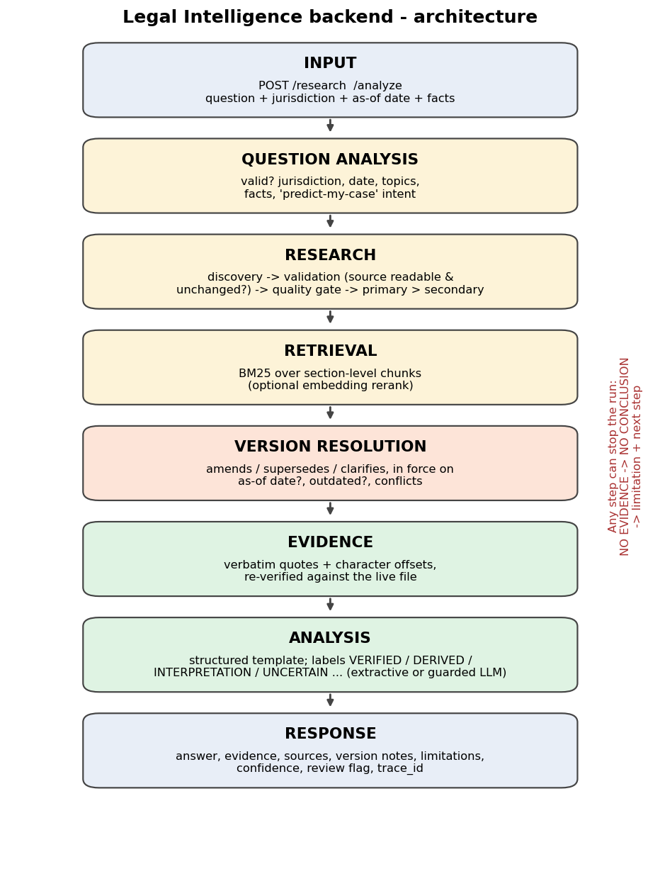
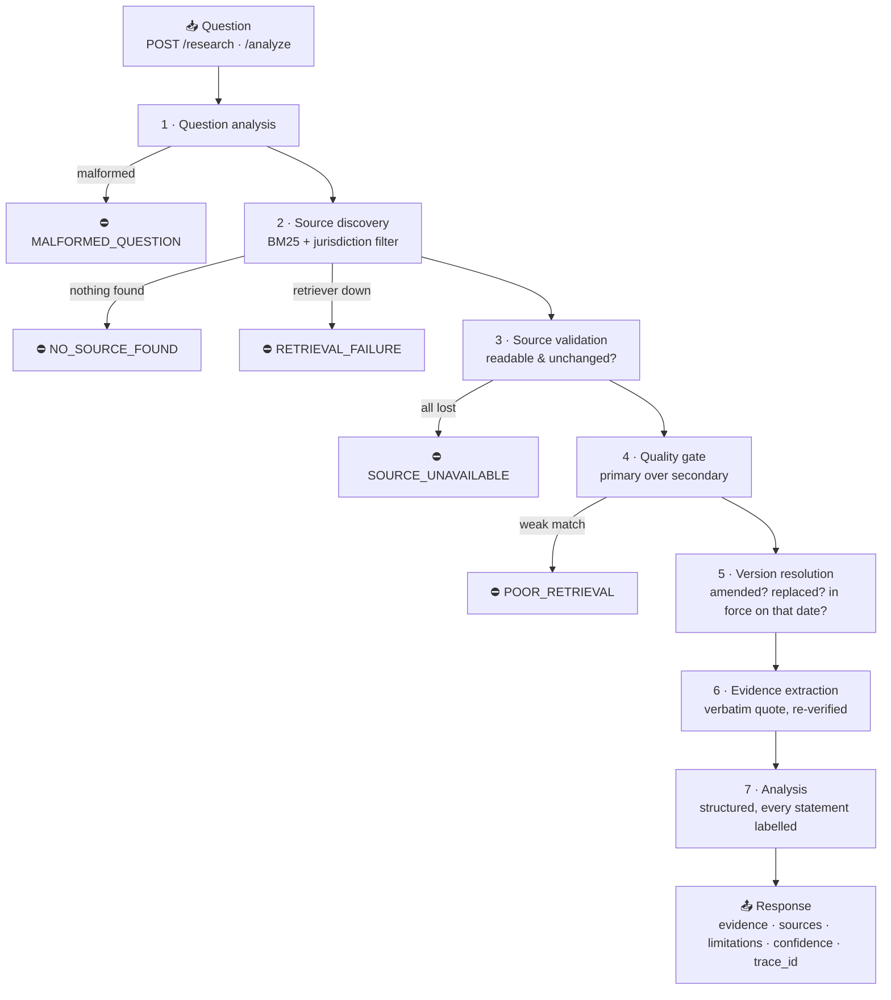

<div align="center">

# ⚖️ Legal Intelligence Backend

### A legal research API that **shows its proof — or says "I don't know."**


**Task 1 · Legal Intelligence Backend Foundation** — by **Srushti Surwase** (AI / ML / Data Science)

</div>

---

## 💡 What is this?

You ask a legal question. The system **finds the exact provisions**, **quotes them word-for-word**, tells you **which version of the law applied on your date**, and **refuses to guess** when the evidence isn't there.

> ### 🧭 One rule drives everything
> **NO EVIDENCE → NO CONCLUSION → EXPLAIN WHY → ASK FOR MISSING FACTS → ESCALATE TO A PROFESSIONAL**

---

## 🏗️ How it works





> ⛔ Any red step **stops the run with no conclusion** and explains why.

---

## ✨ What makes it trustworthy

| | Feature | In one line |
|---|---|---|
| 📜 | **Verified quotes** | Every quote is re-checked against the source file before it is shown |
| 🕰️ | **Version-aware** | Shows old *and* new text, linked, with which one applied on your date |
| ⚔️ | **Conflicts shown, not hidden** | If two sources disagree, both are shown — no silent winner |
| 🏷️ | **Labelled statements** | `VERIFIED` · `SOURCE_DERIVED` · `INTERPRETATION` · `UNCERTAIN` · `MISSING` · `CONFLICTING` |
| 🛑 | **Refuses to guess** | No evidence, weak evidence, or "will I win my case?" → no conclusion |
| 🤖 | **LLM is optional & guarded** | Default mode needs no model; model output is validated or thrown away |
| 🧾 | **Fully traceable** | Every response has a `trace_id`, step-by-step status and system version |

### Example (real output)
*"What is the maximum hours an employee can work in a day?" — as of 2020-06-01*

| | Source | Status on that date | Says |
|---|---|---|---|
| E1 | Act 2010, Sec 4 | ❌ superseded by amendment | 9 hours |
| E2 | Amendment Notification 2019 | ✅ in force | **8 hours** |

→ Both are shown and linked. Ask the same question for **2015** and the answer flips to 9 hours, with the amendment marked *not yet in force*.

---

## 🧰 Tech stack

| Purpose | Technology |
|---|---|
| Language | Python 3.10+ |
| API | FastAPI + Uvicorn |
| Data contracts | Pydantic v2 |
| Retrieval | BM25 (pure Python, offline, explainable) — optional embedding rerank |
| LLM *(optional)* | Anthropic SDK behind a small interface |
| Testing | pytest + httpx |
| Integrity | SHA-256 hashes, corpus fingerprint |

---

## 🚀 Quick start

```bash
python -m venv .venv && source .venv/bin/activate     # Windows: .venv\Scripts\activate
pip install -r requirements.txt
python -m pytest                                       # → 122 passed, 1 skipped
python evaluation/run_eval.py                          # → 19/19 passed
uvicorn app.main:app --reload                          # → http://127.0.0.1:8000/docs
```

Try it:
```bash
curl -s -X POST localhost:8000/analyze -H 'content-type: application/json' \
  -d '{"question": "Do I need to register my shop with 7 employees in Northern Province?"}'
```

---

## 🔌 API

| Endpoint | What it does |
|---|---|
| `GET /health` | Service and corpus health |
| `POST /research` | Finds sources + verified evidence + version notes + limitations |
| `POST /analyze` | Everything above **+ structured legal analysis** (clear / unclear / risk / next step / needs professional review?) |

Request: `{"question": "...", "jurisdiction": "Freedonia", "as_of_date": "2020-06-01", "facts": {"employee_count": 7}}` — only `question` is required.

---

## 🛡️ When things go wrong

| Situation | What the system does |
|---|---|
| No source found | Stops, no answer, explains |
| Source missing or changed | Drops it, names it, continues with the rest |
| Conflicting sources | Shows both, low confidence, review required |
| Weak retrieval | Weak matches listed but **never used as evidence** |
| Malformed question | Stops before searching |
| Missing facts | Lists them; doesn't apply rules to unknown facts |
| Model failure | Falls back to evidence-only analysis, says so |
| "Will I win?" | Shows the provisions, refuses to predict |
| Outdated source | Flagged; prefers the replacing document |
| Unclear jurisdiction | Shows all candidates, asks which applies |
| Dependency down | `status: error`, failing step visible — no answer from memory |

Full table: [`docs/failure_matrix.md`](docs/failure_matrix.md)

---

## ✅ Tests & results

| | Result |
|---|---|
| Automated tests | **122 passed · 0 failed · 1 skipped** |
| Evaluation questions | **19 / 19** behaved as expected |
| Clean-install check | Fresh virtual environment reproduces both results |

The skipped test needs the optional `sentence-transformers` package. Re-run everything yourself — don't trust numbers you haven't reproduced.

---

## 📁 Project structure

```
legal-intelligence/
├── app/            the service: api · pipeline · retrieval · versioning · analysis · fallbacks
├── data/corpus/    documents + metadata
├── evaluation/     19 test questions + runner
├── tests/          pytest suite
├── scripts/        report generators, corpus validator
└── docs/           architecture, reports, study guide, roadmap
```

---

## ⚠️ Honest notes

1. **The bundled documents are fictional** (made-up country "Freedonia", clearly labelled *NOT REAL LAW*). They exist so the system can be tested without inventing real citations. **Real public documents must be added** → [`docs/ADDING_REAL_DOCUMENTS.md`](docs/ADDING_REAL_DOCUMENTS.md)
2. **No starting codebase was provided**, so this was built from scratch.
3. **Built with an AI assistant** (allowed by the brief). Understanding guide: [`docs/STUDY_GUIDE.md`](docs/STUDY_GUIDE.md)
4. **Limits:** keyword-based retrieval (misses synonyms) · conflict detection only compares numbers · version logic relies on correct metadata · local documents only (no live web search) · LLM mode not tested against a live API.
5. **Not legal advice.**

---


## 📚 More documentation

| | |
|---|---|
| [`docs/01_system_understanding.md`](docs/01_system_understanding.md) | System understanding note |
| [`docs/source_version_model.md`](docs/source_version_model.md) | Source & version model |
| [`docs/test_report.md`](docs/test_report.md) · [`evaluation_report.md`](docs/evaluation_report.md) · [`evidence_report.md`](docs/evidence_report.md) | Generated reports |
| [`docs/STUDY_GUIDE.md`](docs/STUDY_GUIDE.md) · [`ROADMAP.md`](docs/ROADMAP.md) | Learning guide and 7-day plan |
| [`docs/learning_report.md`](docs/learning_report.md) | Template — to be written by the candidate |

Screenshot After Running Evaluation 


<div align="center">

*Learn the system by understanding it. Improve it by evidence. Prove it by tests. Leave it reproducible.*

</div>
